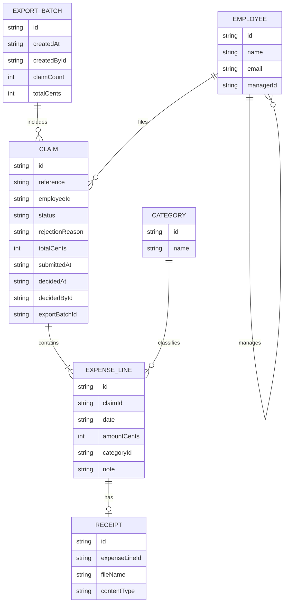

# Domain model

Employees file claims made of expense lines; the employee's line manager decides each claim; Finance exports approved claims in batches.

Claim status is one of draft, submitted, approved, rejected, exported. Employee records are created from the signed-in identity on first use; Finance sets `managerId`. Categories are a fixed seeded list.